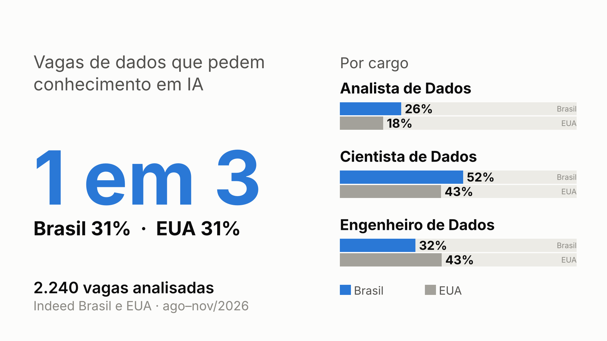
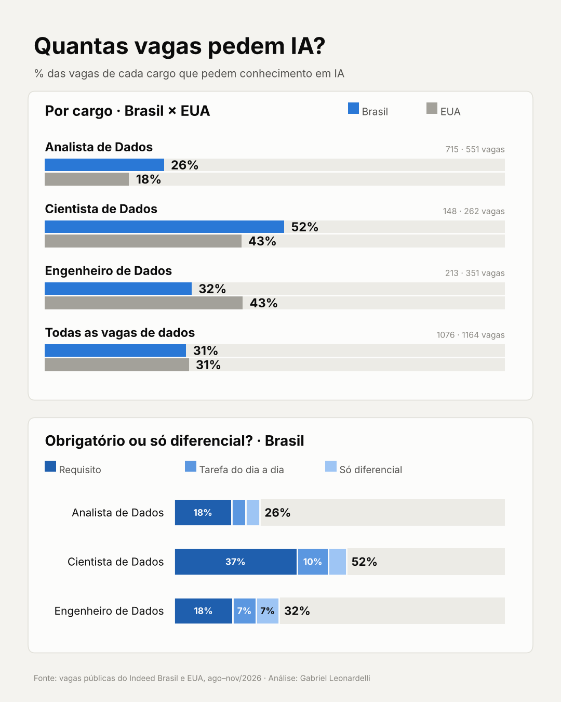
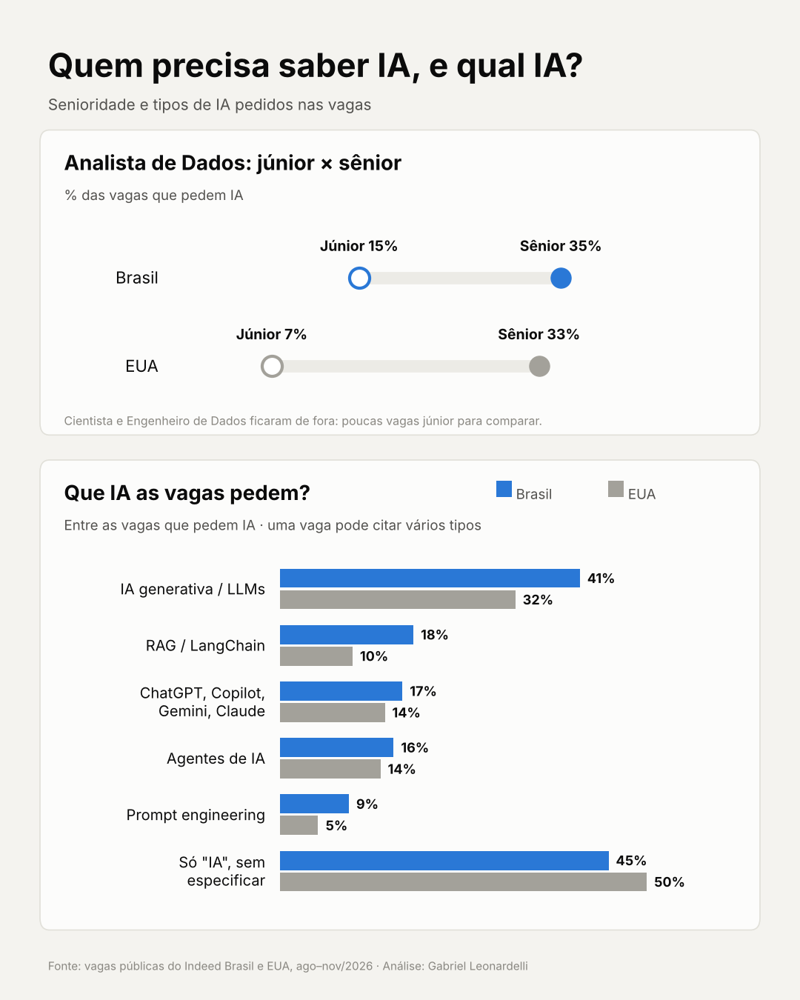

# 🤖 Quantas vagas de dados pedem conhecimento em IA?

> Projeto 3 da série. O projeto 1 ([skills-analista-dados](https://github.com/GabrielLeo12/skills-analista-dados)) mediu as skills pedidas para Analista de Dados; o projeto 2 ([skills-cargos-dados](https://github.com/GabrielLeo12/skills-cargos-dados)) comparou Analista, Cientista e Engenheiro de Dados. Este mede **quantas vagas de dados já pedem conhecimento em IA** — no Brasil e nos EUA, com o mesmo método.

**2.240 vagas** do Indeed (ago–nov/2026): **1.076 no Brasil** (715 Analista · 148 Cientista · 213 Engenheiro) e **1.164 nos EUA** (551 · 262 · 351).



## 🔑 Principais resultados
- **Quase 1 em cada 3 vagas de dados já pede conhecimento em IA**: 31% no Brasil e 31% nos EUA.
- **Por cargo (Brasil × EUA):** Analista de Dados 26% × 18% · Cientista de Dados 52% × 43% · Engenheiro de Dados 32% × 43%.
- **O Analista de Dados brasileiro é mais cobrado por IA que o americano**: 26% (IC 95%: 23–29%) contra 18% (15–22%).
- **Quando pedem, é para valer**: no Brasil, só 5% das vagas trazem IA apenas como diferencial; o resto pede como requisito (20%) ou como tarefa do dia a dia (6%).
- **Júnior × sênior (Analista de Dados):** 15% das vagas júnior pedem IA no Brasil, contra 35% das sênior. Nos EUA: 7% × 33%.
- **Que IA:** IA generativa / LLMs é o tipo mais citado (41% das vagas que pedem IA no Brasil, 32% nos EUA). Cerca de metade fala só em "IA", sem especificar.
- **Vagas remotas pedem mais IA**: 37% no Brasil e 39% nos EUA.




## ❓ Perguntas
1. Quantas vagas de dados pedem conhecimento em IA, por cargo?
2. É requisito obrigatório ou só diferencial?
3. Vaga júnior também pede, ou só a sênior?
4. Que IA pedem: IA generativa, ChatGPT/Copilot, prompt, agentes…?
5. Como o Brasil se compara com os EUA?

## ⚙️ Como foi feito

| Etapa | O que acontece | Arquivo |
|---|---|---|
| 1. Coleta | Buscas no Indeed Brasil e no Indeed EUA, mesmos cargos, vagas dos últimos 90 dias | `src/coleta.py` |
| 2. Limpeza + IA | Junta com as coletas dos projetos 1 e 2 (Brasil), remove repetidas, classifica cargo e senioridade pelo título e detecta se a vaga pede IA | `src/limpeza.py`, `src/ia.py` |
| 3. Validação | Amostras de vagas contadas e não contadas, para leitura | `src/validacao.py` |
| 4. Análise | Tabelas e gráficos das 5 perguntas | `src/analise.py`, `src/graficos.py` |

**Cargos:** as mesmas regras de título do projeto 2 (valem em português e inglês). Híbridos como AI Engineer, ML Engineer, Analytics Engineer e Arquiteto de Dados ficam de fora.

### O que conta como "a vaga pede conhecimento em IA"
Muitas vagas citam IA só na apresentação da empresa ("somos uma empresa focada em IA"). Isso **não** é um pedido ao candidato. Por isso a descrição é lida **por seções**:

| Onde aparece a IA | Conta? | Como |
|---|---|---|
| Requisitos / qualificações / "o que buscamos" | ✅ | **Requisito** (ou Diferencial, se a frase disser "diferencial") |
| Diferenciais / desejável / nice to have | ✅ | **Diferencial** |
| Responsabilidades / dia a dia | ✅ | **Tarefa do dia a dia** (a vaga espera que você use IA no trabalho) |
| Texto sem seção / "sobre a vaga" | ⚠️ | Só se a frase tiver palavra de exigência ("conhecimento", "experiência", "utilizar"…) ou começar com verbo de tarefa, e não for apresentação da empresa |
| Sobre a empresa / benefícios | ❌ | Não conta |
| Título da vaga (ex.: "Analista de Dados e IA") | ✅ | Requisito |

Cada vaga fica com o nível **mais forte**: Requisito > Tarefa do dia a dia > Só diferencial.

**Machine Learning não entra na conta de IA** (é medido à parte, na coluna `pct_cita_ml`): a pergunta é sobre IA no sentido em que o mercado usa a palavra hoje.

### Tipos de IA
| Tipo | Exemplos de termos |
|---|---|
| IA generativa / LLMs | IA generativa, GenAI, LLM, modelos de linguagem |
| Ferramentas | ChatGPT, OpenAI, GPT-4, Copilot, Gemini, Claude |
| Prompt engineering | engenharia de prompt, prompts |
| Agentes de IA | agentes de IA, AI agents, agentic |
| RAG / LangChain / vetores | RAG, LangChain, LlamaIndex, banco vetorial |
| Só "IA", sem especificar | inteligência artificial, IA, AI — só quando a vaga não cita nenhum tipo acima |

Todos os padrões estão em `src/config.py`.

### Validação
`outputs/validacao/amostras_ia.md` traz, por país, 30 vagas contadas (com o trecho que fez a vaga contar) e 20 vagas que citam IA mas não foram contadas. Na leitura de 70 trechos contados (35 de cada país), cerca de 9 em cada 10 eram pedidos reais ao candidato. A leitura levou a três ajustes: não contar avisos sobre uso de IA no processo seletivo ("é proibido usar IA na entrevista"), não contar frases em que a IA é só o destino dos dados ("pipelines que suportam iniciativas de IA") e não contar cursos de formação ("graduação em Ciência da Computação, IA ou afins").

### Margem de erro
Cada % vem com intervalo de confiança de 95% (Wilson) nas tabelas (`ic95_min`, `ic95_max`). Júnior × sênior só é comparado quando os dois grupos têm pelo menos 50 vagas.

## 🚀 Como rodar
```bash
pip install -r requirements.txt
python main.py                 # coleta Brasil + EUA e roda tudo (30 a 60 min)
python main.py --pais EUA      # coleta só um país
python main.py --pular-coleta  # refaz a análise com os CSVs que já estão em data/raw/
```
As coletas dos projetos 1 e 2 entram automaticamente se as pastas `skills-analista-dados` e `skills-cargos-dados` estiverem ao lado desta.

## ⚠️ Limitações
- **Só Indeed**, e só vagas ativas no dia da coleta.
- **Menção não é exigência**: mesmo lendo por seções, a detecção é por palavras. Uma vaga pode pedir IA com palavras que não estão na lista, e uma frase pode ser contada sem ser um pedido real (ver validação).
- **Seções nem sempre existem**: vagas sem títulos de seção dependem da regra de frase, que é menos precisa.
- **EUA × Brasil**: mesmos termos e mesma regra, mas os mercados têm tamanhos muito diferentes; a amostra dos EUA é limitada pelo número de buscas.

## 📁 Estrutura
```
├── main.py
├── src/
│   ├── config.py      # termos de busca, regras de cargo, padrões de IA e de seção
│   ├── coleta.py      # Indeed Brasil e EUA (JobSpy)
│   ├── limpeza.py     # junta, deduplica, classifica e detecta IA
│   ├── ia.py          # lê a descrição por seções e decide se a vaga pede IA
│   ├── validacao.py   # amostras para leitura
│   ├── analise.py     # tabelas e resumo
│   └── graficos.py
├── data/              # raw/ e processed/ (fora do Git)
└── outputs/           # tabelas/ e graficos/
```

---
Feito por **Gabriel Leonardelli** · Dados: vagas públicas do Indeed (Brasil e EUA), coletadas com [JobSpy](https://github.com/speedyapply/JobSpy).
